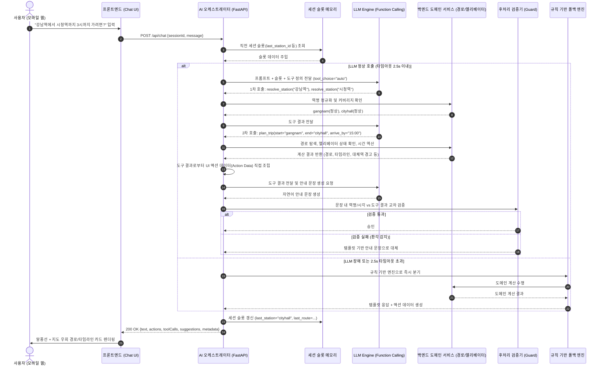
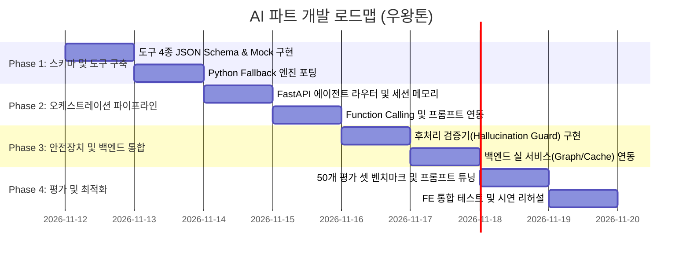

# AI 파트 기술 명세서 및 개발 진행 계획서 (AI Development Spec)

> 본 문서는 [`DESIGN_REVIEW.md`](./DESIGN_REVIEW.md)(AI 파트 설계 검토)에서 도출된 설계 검토 결과 및 수정안을 기반으로, 실제 구현에 착수할 수 있도록 구체적인 아키텍처, 도구 스키마, 오케스트레이션 파이프라인, R&R, 개발 마일스톤을 정의한 기술 문서이다.
>
> 이 문서는 **목표 설계**를 다룬다. 현재 코드가 어디까지 구현되었고 명세와 어떻게 다른지는 [`IMPLEMENTATION_STATUS.md`](./IMPLEMENTATION_STATUS.md)를 참고한다.

---

## 1. 시스템 개요 및 핵심 원칙

### 1.1 핵심 원칙
1. **"LLM은 해석(Interpretation)하고, 백엔드는 계산(Computation)한다"**
   - 최단 경로, 다익스트라 가중치 계산, 대체역 BFS 탐색, 시간 역산은 전적으로 백엔드 도메인 서비스가 수행한다.
   - LLM은 사용자 자연어의 의도 분류(Intent Classification), 슬롯 추출(Slot Extraction), 결과 요약(Natural Language Response)만 담당한다.
2. **액션 데이터의 원천 분리 (Single Source of Truth)**
   - 지도 경로선, 타임라인, 바텀시트 호출용 액션 데이터(Action Data/JSON)는 백엔드가 도구 실행 결과로부터 직접 조립한다.
   - LLM이 액션 데이터를 생성하거나 재작성하지 않으므로 데이터 변조 및 환각(Hallucination) 위험을 원천 차단한다.
3. **교통약자 최우선 보수적 시간 계산**
   - 평균 대기 시간(배차/2)이 아닌 배차 간격 전체 또는 안전 마진을 가산하여, 휠체어 이용자가 절대 약속이나 열차를 놓치지 않도록 보장한다.
4. **결함 없는 도구 체계와 백엔드 정규화**
   - 자유 텍스트 입력을 제거하고, `resolve_station`을 선행 호출하여 고유 ID 기반으로 도구를 실행한다.
   - 1~8호선 역 단위 커버리지 검증을 백엔드가 수행하여 `OUT_OF_COVERAGE`를 정확히 판별한다.
5. **이중 안전장치 (환각 가드 & 규칙 기반 폴백)**
   - 생성된 자연어 답변 속의 역명과 시각이 실제 도구 결과에 존재하는지 백엔드에서 정규식으로 교차 검증한다.
   - LLM API 타임아웃(2.5초 초과) 또는 장애 발생 시, 프로토타입의 규칙 기반 엔진(`ai-agent.js` 로직)을 Python으로 이식한 엔진으로 즉각 폴백한다.
   - ※ 현재 `src/config.py`의 `LLM_TIMEOUT_SECONDS` 기본값은 3.0초로, 이 문서의 2.5초와 다르다. 오케스트레이터 구현 전에 한 값으로 확정해야 한다.

---

## 2. 시스템 아키텍처 및 요청 처리 흐름



---

## 3. 도구(Function Calling Tools) 세부 명세

4개 도구는 단일 책임 원칙과 입력의 엄격성을 준수한다.

### 3.1 `resolve_station` (역명 정규화 및 커버리지 판정)
사용자의 자연어 검색어를 표준 고유 ID(`station_id`)로 변환하고, 서비스 지원 범위(서울교통공사 1~8호선 역 단위) 내에 있는지 확인한다.

- **파라미터 (Parameters)**:
  ```json
  {
    "type": "object",
    "properties": {
      "query": {
        "type": "string",
        "description": "사용자가 언급한 지하철역 명칭 (예: '강남', '강남역', '홍대', '선릉 2호선', '서울대입구역')"
      }
    },
    "required": ["query"]
  }
  ```
- **반환값 (Response)**:
  ```python
  {
    "station_id": str,          # 예: "gangnam", "hongik", "cityhall" (매칭 실패 시 None)
    "name": str,                # 표준 역명 (예: "강남", "홍대입구")
    "lines": list[str],         # 소속 노선 ID 목록, 1~8호선만 (예: ["1", "2"])
    "coverage": "SUPPORTED" | "OUT_OF_COVERAGE" | "NOT_FOUND",
    "confidence": float         # 매칭 신뢰도 (1.0=정확 일치, 0.95=별칭, 0.8=접두어 일치, 0.0=없음)
  }
  ```

### 3.2 `get_elevator_status` (구간 단위 엘리베이터 상태 조회)
특정 역의 엘리베이터 가동 현황을 **구간 단위(이동 축)**로 조회한다.

- **파라미터 (Parameters)**:
  ```json
  {
    "type": "object",
    "properties": {
      "station_id": {
        "type": "string",
        "description": "resolve_station으로 획득한 고유 역 ID (예: 'gangnam', 'cityhall')"
      }
    },
    "required": ["station_id"]
  }
  ```
- **반환값 (Response)**:
  ```python
  {
    "station_id": str,
    "station_name": str,
    "overall_status": "AVAILABLE" | "PARTIAL" | "UNAVAILABLE" | "UNKNOWN",
    "updated_at": str,          # ISO-8601 시각 (예: "2026-11-11T18:55:00+09:00")
    "freshness_minutes": int,   # "○분 전 기준" 표기용
    "segments": [               # 구간 단위 세부 상태
      {
        "segment_id": str,      # 예: "ground_to_concourse", "concourse_to_platform_line2"
        "type": "exit" | "platform" | "transfer",
        "location": str,        # 예: "1번 출구 앞"
        "floors": str,          # 예: "지상 ↔ B1 대합실"
        "status": "AVAILABLE" | "UNAVAILABLE" | "MAINTENANCE",
        "reason": str           # 고장/점검 사유
      }
    ]
  }
  ```

### 3.3 `get_broken_elevators` (노선별 / 전체 고장 목록)
현재 시점에 엘리베이터가 고장(`UNAVAILABLE`) 또는 점검(`MAINTENANCE`) 중인 역 목록을 반환한다.

- **파라미터 (Parameters)**:
  ```json
  {
    "type": "object",
    "properties": {
      "line_id": {
        "type": "string",
        "description": "지하철 노선 ID ('1'~'8'). 전체 고장 조회 시 생략하거나 null 전달."
      }
    }
  }
  ```
- **반환값 (Response)**:
  ```python
  {
    "line_id": Optional[str],
    "count": int,
    "updated_at": str,
    "outages": [
      {
        "station_id": str,
        "station_name": str,
        "line_ids": list[str],
        "broken_count": int,
        "total_count": int,
        "status": "PARTIAL" | "UNAVAILABLE",
        "details": list[dict]
      }
    ]
  }
  ```

### 3.4 `plan_trip` (경로 탐색 + 엘리베이터 우회 + 출발 시각 역산 통합)
기존 `calculate_departure_time`과 `find_route`, 대체역 탐색을 통합한 단일 계산 도구이다.

- **파라미터 (Parameters)**:
  ```json
  {
    "type": "object",
    "properties": {
      "start_id": {
        "type": "string",
        "description": "출발역의 고유 ID (예: 'sindorim')"
      },
      "end_id": {
        "type": "string",
        "description": "도착 희망역의 고유 ID (예: 'gangnam')"
      },
      "arrive_by": {
        "type": "string",
        "description": "도착 희망 시각 (HH:MM 형식, 24시간제). 역산 계산 시 필수."
      },
      "depart_at": {
        "type": "string",
        "description": "출발 희망 시각 (HH:MM 형식, 24시간제). arrive_by가 없을 때 순방향 계산 시 사용."
      },
      "home_walk_min": {
        "type": "integer",
        "description": "현재 위치/출발지에서 출발역 출구까지의 도보 소요 시간(분). 기본값: 7"
      }
    },
    "required": ["start_id", "end_id"]
  }
  ```
- **반환값 (Response)**:
  ```python
  {
    "is_possible": bool,           # false면 경로 계산 미지원 구간. 시간 값을 안내하지 말고 warnings를 전달
    "departure_time": "HH:MM",     # 집/출발지에서 출발해야 하는 권장 시각
    "board_time": "HH:MM",         # 첫 열차 승차 시각
    "arrival_time": "HH:MM",       # 목적지 역 출구 도착 예정 시각
    "minutes_from_now": int,       # 현재 시각 기준 출발까지 남은 여유 시간(분)
    "is_late": bool,               # 이미 늦었거나 목표 시각 준수가 불가능한 경우 true
    "route": {
      "path": ["sindorim", "daerim", ..., "gangnam"],
      "legs": [
        {
          "line_id": "2",
          "from_id": "sindorim",
          "to_id": "gangnam",
          "stops": 12,
          "ride_minutes": 24
        }
      ],
      "total_stops": 12,
      "transfers": 0,
      "total_duration_minutes": 37
    },
    "detours": [                   # 출발/환승/도착역 엘리베이터 불가에 따른 우회 대체역 정보
      {
        "target_type": "end",      # "start" | "transfer" | "end"
        "broken_station_id": "gangnam",
        "alternative_station_id": "yeoksam",
        "alternative_station_name": "역삼",
        "surface_distance_m": 800,
        "surface_walk_minutes": 10,
        "bus_tip": "테헤란로를 따라 146·341번 버스로 1정거장 이동",
        "reason": "강남역 외부 출구 엘리베이터 전체 고장"
      }
    ],
    "breakdown": {
      "home_walk": 7,
      "station_entry_elevator": 3,
      "worst_case_wait": 5,        # 배차 간격(3분) + 안전 여유(2분) 적용
      "subway_ride": 24,
      "transfer_walk": 0,
      "exit_elevator": 3
    },
    "warnings": [
      "강남역 출구 엘리베이터가 고장입니다. 인접한 역삼역 3번 출구 엘리베이터를 권장합니다."
    ]
  }
  ```

---

## 4. 백엔드-프론트엔드 연동 명세 (`/api/chat`)

### 4.1 요청 (Request)
```http
POST /api/chat
Content-Type: application/json

{
  "session_id": "session_abc123",
  "message": "시청역 엘리베이터 고장났다는데 어디로 가야 해?",
  "current_time": "14:15"
}
```

### 4.2 응답 (Response)
백엔드가 직접 액션 데이터(`actions`, `card_data`)를 조립하고, LLM의 텍스트(`text`)와 결합하여 전달한다.
```json
{
  "session_id": "session_abc123",
  "text": "현재 시청역의 외부 출입구 및 승강장 엘리베이터가 모두 점검 중입니다. 휠체어를 이용하실 경우 인접한 을지로입구역(2호선)을 이용하시는 것을 추천합니다. 을지로입구역 1번 출구 엘리베이터는 정상 작동 중입니다.",
  "card_type": "alternative_station",
  "actions": [
    {
      "type": "showAlternative",
      "label": "지도에서 우회 경로 보기",
      "payload": {
        "from": "cityhall",
        "to": "euljiro1ga",
        "path": ["cityhall", "euljiro1ga"]
      }
    },
    {
      "type": "openStation",
      "label": "을지로입구역 상세 보기",
      "payload": { "station_id": "euljiro1ga" }
    }
  ],
  "tool_calls": [
    { "name": "resolve_station", "args": { "query": "시청역" } },
    { "name": "get_elevator_status", "args": { "station_id": "cityhall" } },
    { "name": "plan_trip", "args": { "start_id": "cityhall", "end_id": "cityhall" } }
  ],
  "suggestions": [
    "을지로입구역에서 시청역까지 어떻게 가?",
    "지금 시청역 출발하면 언제 도착해?"
  ],
  "metadata": {
    "engine": "llm",
    "latency_ms": 1180,
    "fallback_used": false,
    "data_updated_at": "2026-11-11T14:10:00+09:00"
  }
}
```

---

## 5. 프롬프트 및 컨텍스트 엔지니어링

### 5.1 시스템 프롬프트 명세
> 실제 코드: `src/llm/prompts.py`의 `SYSTEM_PROMPT_TEMPLATE`. 문구를 바꿀 때는 코드와 이 절을 함께 고친다.

```text
당신은 수도권 지하철 교통약자(휠체어, 유모차 이용자 등)를 위한 AI 이동 안내 비서 '우왕이'입니다.

[핵심 행동 수칙]
1. 당신은 스스로 경로, 시간, 엘리베이터 상태를 절대 계산하거나 추측하지 않습니다.
2. 모든 정보는 반드시 제공된 도구(resolve_station, get_elevator_status, get_broken_elevators, plan_trip)를 호출하여 확인한 뒤 안내합니다.
3. 역명이 언급되면 항상 resolve_station을 먼저 호출하여 고유 ID를 확인하십시오. coverage가 SUPPORTED가 아니면 지원하지 않는 역이라고 안내하십시오.
4. 사용자 질의에 출발역이 생략되어 있고 시간 역산을 요구할 경우, 세션 컨텍스트의 last_station_id를 확인하고, 그것도 없다면 기본값("sindorim", 신도림역)을 출발역으로 지정하여 계산하고 사용자에게 "출발역이 지정되지 않아 신도림역 기준으로 안내합니다"라고 명확히 밝히십시오.
5. 시각은 반드시 HH:MM(24시간제)으로 바꿔 도구에 전달하십시오. 예: "3시 반" → "15:30".
6. 안내 문장은 정중하고 명확하게 작성하며, 도구 결과에 명시된 시각, 역명, 우회 팁만을 사실 그대로 전달하십시오.
7. 도구 결과 외의 임의의 역명이나 임의의 소요 시간을 지어내어 말하면 절대 안 됩니다. 도구가 error나 is_possible=false를 반환하면 그 사실을 그대로 알리십시오.

[현재 세션 컨텍스트]
- 현재 기준 시각: {current_time}
- 최근 조회/언급 역: {last_station}
- 최근 경로: {last_route_summary}
```

### 5.2 세션 슬롯 메모리 관리
- 세션 객체:
  ```python
  class SessionContext(BaseModel):
      session_id: str
      last_station_id: Optional[str] = None
      last_station_name: Optional[str] = None
      last_route: Optional[dict] = None
      last_query_type: Optional[str] = None
      updated_at: datetime = Field(default_factory=datetime.now)
  ```
- 인메모리 TTL 캐시(30분)로 관리하여 메모리 누수를 방지한다.

---

## 6. 안전장치: 후처리 검증(Guard) 및 규칙 기반 폴백(Fallback)

### 6.1 후처리 환각 검증기 (Hallucination Guard)
LLM이 생성한 `text`에 대해 백엔드가 2차 필터링을 수행한다:
1. **시각 정규식 추출**: `r"(\d{1,2}시\s*\d{1,2}분|\d{1,2}:\d{2})"` 패턴으로 언급된 모든 시각을 추출.
2. **역명 정규식 추출**: `r"([가-힣]{2,8}역)"` 패턴으로 언급된 모든 역명을 추출.
3. **교차 검증**:
   - 추출된 역명과 시각이 `tool_calls` 결과 데이터셋 내에 존재하는지 검사.
   - 불일치 발생(예: 도구 결과는 14:48 출발인데 텍스트는 14:30 출발이라고 씀) 시, LLM 텍스트를 폐기하고 도구 결과 기반의 안전한 표준 템플릿 문장으로 치환한다.

### 6.2 규칙 기반 폴백 엔진 (Rule-based Fallback)
- 프로토타입 `FE/Prototype-v2/js/ai-agent.js`의 의도 판별 및 정규식 로직을 Python `FallbackEngine` 클래스(`src/fallback/engine.py`)로 포팅. 의도 분류 점수표와 시각 파싱 규칙은 [`IMPLEMENTATION_STATUS.md` §3](./IMPLEMENTATION_STATUS.md#3-폴백-엔진-fallbackengineprocess) 참고.
- LLM API 타임아웃(2.5초), Rate Limit(429), Network Error 발생 시 즉시 `FallbackEngine.process()`를 호출하여 동일한 스키마(`ChatResponse`, `metadata.engine="fallback"`)의 응답을 반환한다.

---

## 7. AI 파트와 백엔드 파트 간 R&R (역할 분담)

| 영역 | AI 파트 담당 업무 | 백엔드(BE) 파트 담당 업무 |
|---|---|---|
| **도구 인터페이스** | Function Calling 도구 스키마(JSON Schema) 설계 및 검증 | 도구 실행 비즈니스 로직(Graph Dijkstra, BFS, DB 연동) 구현 |
| **API 엔드포인트** | `POST /api/chat` 오케스트레이션 엔드포인트 구현 | `POST /api/routes`, `GET /api/elevators` 개별 도메인 엔드포인트 |
| **자연어 처리** | 의도 분류, 프롬프트 엔지니어링, 슬롯 추출, LLM 클라이언트 | 역명 사전 구축, 공공데이터 수집 및 동기화 스케줄러 |
| **데이터 변환** | LLM 응답 후처리 검증, UI 액션 데이터 매핑 및 통합 | 도메인 DTO 및 원천 엔티티 모델링 |
| **안정성** | 규칙 기반 폴백 엔진 포팅, 타임아웃 처리 | Redis 실시간 캐싱, DB 고가용성 및 트랜잭션 관리 |
| **품질 평가** | 벤치마크 테스트셋 구축(50문항), 의도/슬롯 추출 정확도 측정 | 알고리즘 소요 시간 벤치마크, 서버 부하 테스트 |

---

## 8. 정량적 평가 계획 (Evaluation Benchmark)

### 8.1 벤치마크 데이터셋 구성 (총 50개 질의)
1. **엘리베이터 상태 질의 (10건)**:
   - "강남역 2번 출구 엘리베이터 돼?", "시청역 엘리베이터 상태 어때?", "홍대입구역 휠체어 이용 가능해?" 등
2. **대체역 및 고장 우회 질의 (10건)**:
   - "강남역 고장났는데 어디로 가?", "시청역 엘리베이터 안 되면 어떡하지?", "대체역 알려줘" 등
3. **출발 시각 역산 질의 (15건)**:
   - "신도림에서 잠실까지 3시 반까지 가려면?", "강남역까지 5시 약속인데 언제 나와야 해?", "지금 출발하면 언제 도착해?" 등
4. **문맥 연속 대화 질의 (10건)**:
   - (강남역 조회 후) "거기 대체역은?", "도착역까지 몇 분 걸려?", "다른 노선은?" 등
5. **커버리지 밖 / 미지원 역 질의 (5건)**:
   - "판교역 엘리베이터 상태는?", "정자역 가려면?", "부산역 KTX 타려면?" 등

### 8.2 정량적 목표 지표 (KPI)
- **도구 호출 정확도 (Tool Selection Accuracy)**: 98% 이상
- **슬롯 추출 정확도 (Slot Extraction F1-Score)**: 95% 이상
- **환각 발생률 (Hallucination Rate)**: 0.0% (후처리 검증 통과 후 기준)
- **응답 레이턴시 (Response Latency)**: P95 기준 2.0초 이내 (폴백 발동 시 100ms 이내)

---

## 9. 단계별 개발 마일스톤 및 세부 일정



### Phase 1: 계약 확정 및 로직 포팅 (D+1 ~ D+2)
- 4개 도구(`resolve_station`, `get_elevator_status`, `get_broken_elevators`, `plan_trip`)의 Pydantic 스키마 및 Mock 함수 작성.
- 프로토타입의 `js/ai-agent.js` 로직을 Python `FallbackEngine`으로 완전 포팅하여 100% 동작하는 베이스라인 확보.

### Phase 2: 오케스트레이터 및 Function Calling 연동 (D+3 ~ D+4)
- FastAPI 기반 `/api/chat` 엔드포인트 구현.
- LLM 클라이언트 연동 및 비동기 처리(`async/await`).
  - 초기 계획은 OpenRouter / Gemini였으나, 무료 모델이 불안정하여 **학교 마인드로직 FactChat 게이트웨이**(OpenAI 호환 API, `claude-sonnet-5` / `gpt-4o-mini` 등)로 전환했다. 연동 검증 스크립트: `scripts/llm_demo.py`.
  - NVIDIA 게이트웨이(`integrate.api.nvidia.com`, `z-ai/glm-5.3-flash`)도 후보로 도구 호출 여부를 실험 중이다: `scripts/llm_demo.py --provider nvidia`.
- 세션 슬롯 메모리(인메모리 TTL 딕셔너리) 및 시스템 프롬프트 동적 주입 구현.

### Phase 3: 안전 가드 및 백엔드 도메인 서비스 연동 (D+5 ~ D+6)
- 후처리 검증기(Hallucination Guard) 구현 (정규식 기반 역명/시각 대조).
- 백엔드 팀의 실제 도메인 서비스(다익스트라 알고리즘, 실시간 엘리베이터 상태 캐시)와 도구 연동.
- 액션 데이터 자동 조립 빌더 구현.

### Phase 4: 평가 벤치마크 및 시연 통합 (D+7 ~ D+8)
- 50개 평가 벤치마크 스크립트 실행 및 정확도 측정.
- 프롬프트 및 Few-shot 튜닝을 통한 실패 케이스 보정.
- 프론트엔드 모바일 웹과의 통합 E2E 테스트 및 장애 시나리오 시연 검증.

