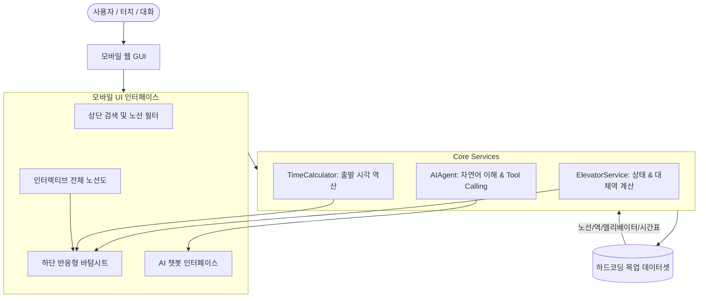

# [CARD-002] 모바일 최적화 웹 프로토타입 아키텍처 및 상세 설계

- **작업 레벨**: Standard
- **상태**: 설계 작성 완료 (Ready for Review)
- **작성일**: 2026-10-28

---

## 1. 아키텍처 및 파일 구조 설계

외부 의존성(Node.js, npm, Webpack 등) 없이 브라우저에서 독립 실행 가능한 Vanilla Web 구조로 설계합니다.

```
c:\woowang_thon\Prototype\
├── index.html               # 모바일 최적화 메인 웹 앱 컨테이너
├── css\
│   └── style.css            # 모바일-퍼스트 UI 디자인 시스템, 다크/모던 테마, 애니메이션
└── js\
    ├── mock-data.js         # 수도권 전체 노선도 좌표, 역 메타데이터, 엘리베이터 목업 상태, 열차 시간표
    ├── metro-map.js         # 전체 노선도 SVG 렌더링, 줌/팬(Zoom/Pan), 역 선택 및 상태 뱃지 인터랙션
    ├── elevator-service.js  # 엘리베이터 상태 관리, 고장 시 인접 대체역 탐색 알고리즘
    ├── time-calculator.js   # 열차 배차/이동 시간 기반 출발 시각 역산 계산 엔진
    ├── ai-agent.js          # 자연어 파싱, 의도(Intent) 분석, 도구 호출 시뮬레이션 및 챗봇 엔진
    └── app.js               # 바텀 시트, 탭 전환, 이벤트 바인딩 및 앱 초기화 총괄
```

---

## 2. 데이터 흐름 (Data Flow)



### 상세 데이터 흐름
1. **노선도 탐색**:
   - `metro-map.js`가 `mock-data.js`의 노선 좌표 데이터를 읽어 전체 노선망을 SVG로 렌더링.
   - 역 터치 시 `ElevatorService`에 해당 역 상태를 조회하고, `app.js`가 하단 바텀 시트를 띄움.
2. **엘리베이터 고장 & 대체역 우회**:
   - 사용자가 역 상세창에서 "고장 테스트 토글"을 누르면 실시간으로 상태가 `UNAVAILABLE`로 변경.
   - `ElevatorService.findAlternativeStation(stationId)`가 호출되어 인접 연결 역 중 가장 가까운 `AVAILABLE` 역을 탐색하여 지도에 대체 경로 점선 및 바텀 시트에 우회 방법 표시.
3. **출발 시간 계산**:
   - 사용자가 출발역, 도착역, 목표 도착 시각을 선택하면 `TimeCalculator.calculateDeparture(origin, dest, targetTime)`가 다음 열차 시각과 걷기 시간을 계산하여 "지금으로부터 X분 후(HH:MM) 출발"을 산출.
4. **AI 챗봇 질의응답**:
   - 챗봇 입력창에 자연어 질문 입력 → `AIAgent.processMessage(text)`가 정규식 및 의도 분류기를 통해 분석:
     - "강남역 엘리베이터 돼?" → `Tool: check_elevator` 호출 → 상태 및 위치 카드 출력.
     - "시청역 고장났는데 어디로 가야 해?" → `Tool: find_alternative` 호출 → 인접 대체역 및 이동 방법 카드 출력.
     - "신도림에서 강남까지 3시까지 가려면?" → `Tool: calculate_departure` 호출 → 권장 출발 시간 카드 출력.

---

## 3. 대안 및 선택 이유 (Standard 요구사항)

| 항목 | 선택안 (대안 A) | 비교 대안 (대안 B) | 선택 이유 |
|---|---|---|---|
| **구현 방식** | **순수 HTML5 + Vanilla JS + CSS3** | React/Next.js 기반 웹앱 | 사용자의 명시적 요청("우선 html, css, js와 하드코딩으로만 만들어")에 완벽 부합하며, 빌드나 설치 없이 브라우저에서 바로 열 수 있어 프로토타입 시연 및 검증 속도가 가장 빠름 |
| **노선도 시각화** | **인터랙티브 SVG 벡터 렌더러** | 고정 래스터 이미지(PNG/JPG) | 모든 노선의 미려한 시각화와 확대/축소(Pinch-to-zoom), 역 단위 클릭 이벤트 바인딩 및 실시간 상태 뱃지 애니메이션에 SVG가 최적 |
| **모바일 UI 구조** | **CSS Mobile Container + Bottom Sheet** | 일반 데스크톱 반응형 그리드 | 모바일 웹 GUI 최적화 요청에 맞춰 카카오지하철/네이버지도 앱과 같은 네이티브 앱 느낌의 바텀 시트와 플로팅 UI 제공 |

---

## 4. 세부 컴포넌트 설계

1. **디자인 시스템 (CSS)**:
   - 폰트: 시스템 기본 산세리프 및 가독성 높은 모바일 폰트
   - 노선 컬러:
     - 1호선: `#0052A4`
     - 2호선: `#00A84D`
     - 3호선: `#EF7C1C`
     - 4호선: `#00A5DE`
     - 5호선: `#996CAC`
     - 6호선: `#CD7C2F`
     - 7호선: `#747F00`
     - 8호선: `#E6186C`
     - 9호선: `#BDB092`
     - 신분당선: `#D4003B`, 수인분당: `#FABE00`, 공항철도: `#0090D2`
   - 테마: 깔끔한 글래스모피즘 + 모던 다크/라이트 카드, 터치 피드백 햅틱 애니메이션
2. **모바일 뷰포트 & 데스크톱 래퍼**:
   - 모바일 기기(아이폰/갤럭시) 화면 비율(기본 390×844px)을 유지하는 중앙 정렬 폰 프레임 제공.
   - 데스크톱에서도 실제 모바일 폰을 조작하는 듯한 직관적이고 몰입감 있는 환경 제공.
3. **AI Agent 프롬프트 및 응답 템플릿**:
   - 텍스트 말풍선뿐 아니라, 시각적인 지하철 뱃지, 엘리베이터 상태 태그, 출발 타임라인이 포함된 리치 카드 렌더링.
